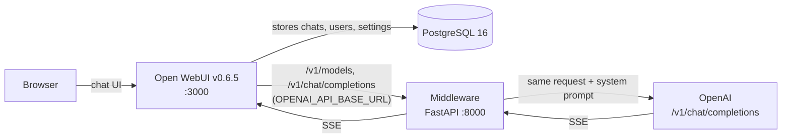
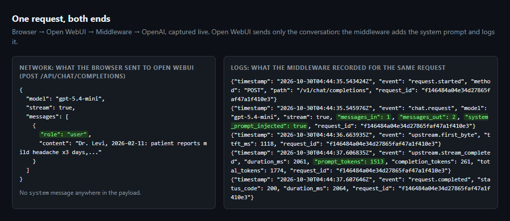
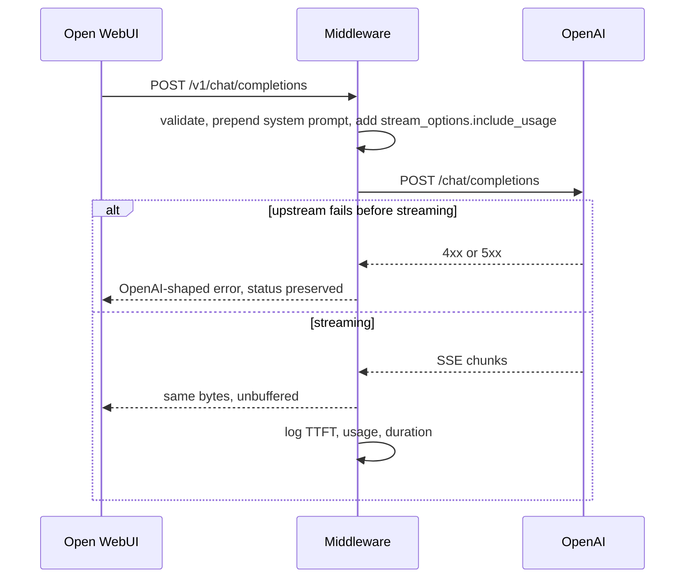

# Open WebUI + Middleware Stack

[](https://github.com/tomBold/openwebui-middleware/actions/workflows/ci.yml)

```text
 _________________________________________________
< Moo. Every request leaves with a system prompt. >
 -------------------------------------------------
        \   (__)
         \  (oo)
     /-------\/
    / |     ||
   *  ||----||
      ^^    ^^
```

*The cow is the 1991 classic from the [Complete Guide to Cows](https://www.asciiart.eu/collections/summer-1991-part-1-the-classic-cows), edited by David A. Bader, artist unknown, grandparent of every `cowsay`. Found via [ASCII Art Archive](https://www.asciiart.eu), the home of classic text art.*

Open WebUI 0.6.5 backed by PostgreSQL, talking to OpenAI through a FastAPI middleware that injects a structured-extraction system prompt into every chat request and streams the response straight back.



Three services, three jobs. Open WebUI is the chat application and owns the state: chats, users and settings live in PostgreSQL. The middleware is stateless and never touches the database; it only sits on the path to OpenAI. What it forwards is the client's request untouched plus two additions: the system prompt inserted as the first message, and `stream_options.include_usage` when streaming so token usage can be logged. Nothing is removed, rewritten or redacted.

## Run it locally

Requirements: Docker Desktop and an OpenAI API key. Python is only needed to run the tests.

```bash
git clone https://github.com/tomBold/openwebui-middleware.git && cd openwebui-middleware
./scripts/start.sh            # Windows: powershell -File scripts/start.ps1
```

The script creates `.env` from `.env.example`, prompts for the key, starts the three services, waits until they answer and prints the addresses: <http://localhost:3000> for Open WebUI and <http://localhost:8000> for the middleware. Users only ever open Open WebUI; the middleware address exists for verification. If a port is taken, change `OPEN_WEBUI_PORT` or `MIDDLEWARE_PORT` in `.env` and rerun. Manual equivalent: `cp .env.example .env`, edit the key, `docker compose up -d --build`. [RUNBOOK.md](RUNBOOK.md) is the same journey as a checklist with expected output at each step.

### Configuration

Everything is read from `.env`. After changing a value, `docker compose up -d` applies it (a plain `restart` does not re-read `.env`).

| Variable | Default | Meaning |
| --- | --- | --- |
| `OPENAI_API_KEY` | required | Your key. Only the middleware ever sees it. |
| `OPENAI_BASE_URL` | `https://api.openai.com/v1` | Upstream to forward to; any OpenAI-compatible endpoint works. |
| `OPENAI_MODELS` | `gpt-6-luna,gpt-5.6-luna,gpt-5.4-mini` | Allowlist shown to Open WebUI. Empty means every model the key can see. |
| `LOG_LEVEL` | `INFO` | Standard Python level names; anything else fails at startup. |
| `LOG_JSON` | `true` | `false` prints the same events as aligned text. |
| `UPSTREAM_CONNECT_TIMEOUT` | `10` | Seconds to establish a connection to OpenAI. |
| `UPSTREAM_READ_TIMEOUT` | `120` | Seconds to wait for OpenAI between bytes. |
| `READINESS_TIMEOUT` | `5` | Budget for the `/ready` probe. |
| `OPEN_WEBUI_PORT`, `MIDDLEWARE_PORT` | `3000`, `8000` | Host ports, bound to `127.0.0.1` so nothing on your network can spend your key. |
| `WEBUI_AUTH` | `false` | Open WebUI login screen off for local use; the smoke test needs it off. |
| `WEBUI_SECRET_KEY` | `local-dev-secret` | Open WebUI session signing key. |
| `POSTGRES_USER`, `POSTGRES_PASSWORD`, `POSTGRES_DB` | `openwebui` | Database credentials, used only inside the compose network. |

### Getting an OpenAI API key

At <https://platform.openai.com>: **Billing**, add credit ($5 is plenty; an extraction costs about $0.001). **API keys**, **Create new secret key**, copy it into `OPENAI_API_KEY`. `GET /ready` then tells you whether it works: `{"status":"ready"}` or `{"status":"upstream_unavailable"}`.

Following OpenAI's [key safety guidance](https://help.openai.com/en/articles/5112595-best-practices-for-api-key-safety), the key can be **Restricted** to exactly what this service calls:

| Scope | Level | Used by |
| --- | --- | --- |
| List models | Read | `GET /ready`, `GET /v1/models` |
| Model capabilities > Chat completions | Request | `POST /v1/chat/completions` |

> **Caveat worth knowing.** Restricted keys have a [documented failure mode](https://community.openai.com/t/missing-scopes-model-request-on-restricted-api-key/1371602) where selecting a single child scope sets `api.model.chat_completions.request` without the parent `model.request`, and every call returns `401 Missing scopes: model.request`. OpenAI shipped a fix in May 2026, but reports of regressions continue. The scopes above were verified against the live API for this project. If you hit that error, switch the key to **All** permissions.

`.env` is the only place a secret lives, it is gitignored, and Open WebUI never receives the real key: it is given a dummy one and only reaches OpenAI through the middleware.

## Verify it end to end

### The real flow: Open WebUI

Open the Open WebUI URL, pick a model, paste any messy text. Open WebUI sends a plain user message; the middleware adds the system prompt before anything reaches OpenAI. The browser's network tab shows the request leaving with no `system` entry, and the middleware log for the same request shows `"messages_in": 1, "messages_out": 2, "system_prompt_injected": true`.




### Reading the logs

`docker compose logs -f middleware` prints one structured line per lifecycle event. Every line for one request carries the same `request_id`, also returned to the caller as `X-Request-ID`.

| Event | Fields | Meaning |
| --- | --- | --- |
| `app.started` | `upstream`, `models`, `system_prompt_chars` | Once at boot |
| `request.started` | `method`, `path` | Request accepted |
| `chat.request` | `model`, `stream`, `messages_in`, `messages_out`, `system_prompt_injected` | Prompt prepended; one more message leaves than arrived |
| `upstream.first_byte` | `ttft_ms` | OpenAI started answering |
| `upstream.stream_completed` | `duration_ms`, `prompt_tokens`, `completion_tokens`, `total_tokens`, `cached_tokens` | Stream finished, usage read off the final chunk |
| `chat.completed` | same usage fields | Non-streaming equivalent |
| `request.completed` | `status_code`, `duration_ms` | Response fully sent |

Failures are `warning` events that never hide the status: `upstream.error` when OpenAI answers 4xx or 5xx (relayed as is), fails to connect (502) or times out (504); `upstream.stream_failed` when the connection drops mid-stream, after which the client gets an SSE error event and `[DONE]`; `readiness.failed` when `/ready` cannot reach OpenAI and answers 503.

With `LOG_JSON=false` the same run with a rejected key reads:

```text
2026-10-30T04:51:11.109566Z [info     ] request.started                method=POST path=/v1/chat/completions request_id=c0e82dd3c9214a42a4a5e67c3d5cdecd
2026-10-30T04:51:11.114973Z [info     ] chat.request                   messages_in=1 messages_out=2 model=gpt-5.4-mini request_id=c0e82dd3c9214a42a4a5e67c3d5cdecd stream=True system_prompt_injected=True
2026-10-30T04:51:11.462450Z [warning  ] upstream.error                 error='Incorrect API key provided: sk-inval*********pose. You can find your API key at https://platform.openai.com/account/api-keys.' error_type=invalid_request_error request_id=c0e82dd3c9214a42a4a5e67c3d5cdecd status_code=401
2026-10-30T04:51:11.468500Z [info     ] request.completed              duration_ms=361 request_id=c0e82dd3c9214a42a4a5e67c3d5cdecd status_code=401
```

### Verification tooling: the middleware address

Not part of the user flow. <http://localhost:8000> serves a status page: liveness, readiness against OpenAI, the models Open WebUI will see, and a form that streams a sample through the same `POST /v1/chat/completions`.


```bash
./scripts/smoke.sh            # health, readiness, models, a streaming completion, then one chat through Open WebUI's API
curl localhost:8000/health    # {"status":"ok"}
curl localhost:8000/ready     # {"status":"ready"} once OpenAI accepts your key
```

The smoke test's last step sends a chat through Open WebUI's own API with no system prompt in the request and asserts the reply is still the extraction envelope, which only the middleware could have produced.

## How it works



| Endpoint | Purpose |
| --- | --- |
| `GET /` | Status page. Static HTML that calls the endpoints below. |
| `GET /health` | Liveness. Never touches OpenAI. |
| `GET /ready` | Readiness. Calls OpenAI `/models`; 503 when unreachable or the key is rejected. |
| `GET /v1/models` | Model discovery for Open WebUI, filtered by `OPENAI_MODELS`. |
| `POST /v1/chat/completions` | Injects the prompt, forwards, streams back. |

Open WebUI 0.6.5 calls exactly two OpenAI endpoints: `/models` to fill the model picker at startup, and `/chat/completions` for every message. Without the first it cannot send a single chat, which is why the proxy serves both and nothing else.

SSE, Server-Sent Events, is how OpenAI streams: the HTTP connection stays open and the reply arrives as a series of `data:` lines, each one a chunk of a few tokens, ending with `data: [DONE]`. That is why text appears word by word in the chat, and why the middleware relays the bytes as they arrive instead of waiting for the whole answer. It reads the stream on the side to pick up the final `usage` chunk for the log.

## The system prompt

The prompt is [SYSTEM_PROMPT.md](SYSTEM_PROMPT.md), with the design reasoning, the edge cases and what was iterated. The middleware loads it from `middleware/app/prompts/system_prompt.md` at startup, and a unit test asserts the two files never drift. The assignment's three demands each map to a required key, so the model cannot skip any of them:

- **Identify the type of text**: `document_type`, the first key, a lower_snake_case label with `unknown` as the escape hatch for unreadable input instead of a refusal.
- **Extract into a consistent JSON block**: exactly one fenced `json` block with seven fixed top-level keys in a fixed order; `entities` is open so a receipt and a medical report can carry different fields, with normalised dates, times and currencies, and `missing_fields` makes absence visible instead of silently dropped.
- **Flag uncertainty with a confidence score**: every value is `{"value", "confidence"}` on a defined 0 to 1 scale, and `uncertain_fields` lists every leaf below 0.8 with a dot path and a reason.

Follow-up questions are detected per turn by the prompt itself and answered in prose grounded in the last extraction, quoting the confidence when the field was flagged.

OpenAI Structured Outputs (`response_format: json_schema`) would guarantee valid JSON but was deliberately not used: it applies to every turn, so follow-ups could no longer be answered in prose, and strict mode forbids the open `entities` keys. The assignment also frames the task as a system prompt, so format compliance comes from the prompt: fixed keys, explicit bans on the real failure modes (prose around the block, two blocks, comments, trailing commas) and a worked example.

## Design decisions

- **Prompt injected server-side, not in Open WebUI.** The contract holds for every client and cannot be edited away in the UI. It is prepended as the first message, so a system prompt configured in Open WebUI still arrives and is simply subordinate. Being first and byte-identical on every request also makes it a cacheable prefix for OpenAI's [prompt caching](https://developers.openai.com/api/docs/guides/prompt-caching): the roughly 1,500 prompt tokens it costs are billed at the cached rate from the second request on, and `cached_tokens` in the completion log shows the hit (1,408 of 1,523 in a live run).
- **Streaming is a byte passthrough.** Upstream SSE chunks are relayed as they arrive rather than parsed and re-serialised, so time to first token matches the upstream and no OpenAI field is accidentally dropped.
- **Failures stay in the OpenAI error shape.** Upstream 4xx and 5xx keep their status, message and type; connect errors become 502 and timeouts 504; a 200 with an unparseable body is a 502 rather than a crash. A mid-stream failure cannot change the status code, so it is emitted as an SSE error event followed by `[DONE]`, which Open WebUI renders instead of hanging.
- **Two kinds of health.** `/health` answers whether the process is alive, `/ready` whether it can serve traffic. Compose gates Open WebUI on the container healthcheck so the model list is never fetched from a dead middleware.
- **Background generation disabled.** Open WebUI 0.6.5 generates chat titles, tags, autocomplete and search queries through the same chat endpoint, which the extractor prompt would answer with JSON. Those features are turned off in compose.
- **Config is environment-only and persistent config is off.** `OPENAI_API_BASE_URL` is an Open WebUI `ConfigVar` that would otherwise be frozen at first boot, making a rebuild silently ignore `.env`.
- **PostgreSQL over SQLite.** The assignment asks for a database service, and it matches how Open WebUI runs outside single-user setups.

## Development

```bash
make test-docker   # tests, lint and types inside the image's test stage; nothing installed on the host
make test          # the same on the host via uv (cd middleware && uv run pytest)
make lint          # ruff check, ruff format --check
make typecheck     # mypy --strict
make check         # all of the above, what CI runs
```

Host runs need [uv](https://docs.astral.sh/uv/), which creates the environment from `middleware/uv.lock` and fetches Python 3.12 itself if no 3.11+ is installed. 43 tests run in about a second; OpenAI is mocked with `respx`, so no key and no network. Coverage is printed and the run fails below 90%.

CI runs the same commands on Python 3.11, 3.12 and 3.13 on Ubuntu 24.04 and 3.12 on macOS, lints the shell scripts and the Markdown, runs the Docker `test` stage and checks the built image serves `/health`. Optional hooks: `uv run --project middleware pre-commit install`.

Without Docker:

```bash
cd middleware
OPENAI_API_KEY=sk-... uv run uvicorn app.main:create_app --factory --reload
```
