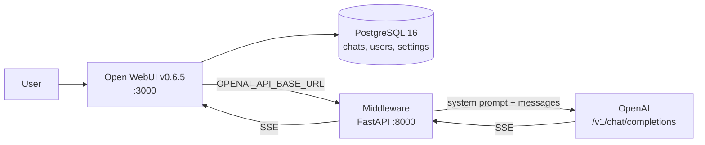
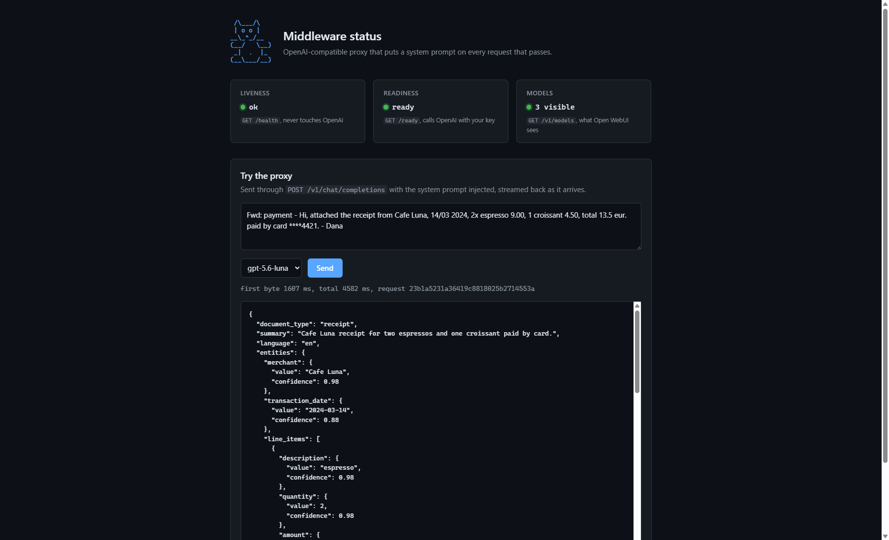
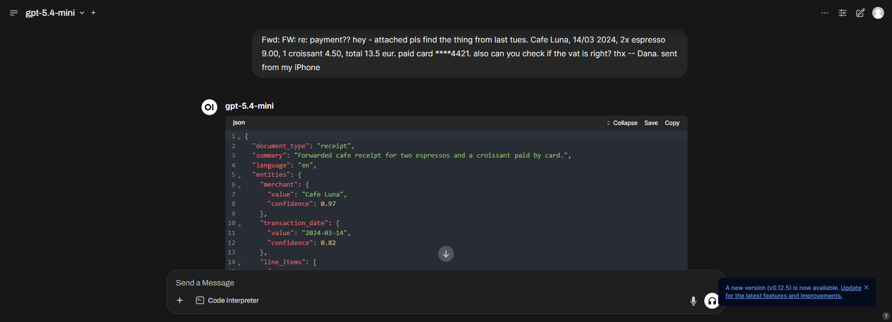
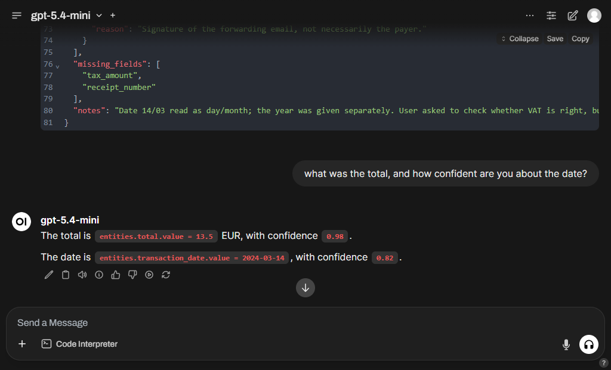
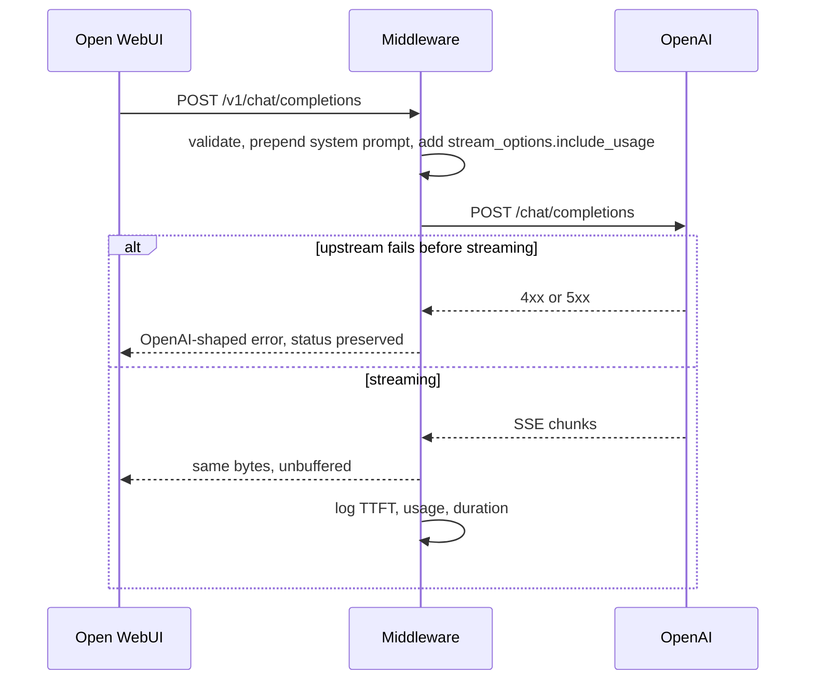

# Open WebUI + Middleware Stack

[](https://github.com/tomBold/openwebui-middleware/actions/workflows/ci.yml)

```text
 _________________________________________________
< Moo. Every request leaves with a system prompt. >
 -------------------------------------------------
        \   (__)
         \  (oo)
     /-------\/
    / |     ||
   *  ||----||
      ^^    ^^
```

*The cow is the 1991 classic from the [Complete Guide to Cows](https://www.asciiart.eu/collections/summer-1991-part-1-the-classic-cows), edited by David A. Bader, artist unknown, grandparent of every `cowsay`. Found via [ASCII Art Archive](https://www.asciiart.eu), the home of classic text art.*

Open WebUI 0.6.5 backed by PostgreSQL, talking to OpenAI through a FastAPI middleware that injects a structured-extraction system prompt into every chat request and streams the response straight back.



## Run it locally

Requirements: Docker Desktop and an OpenAI API key. Nothing else; Python is only needed to run the tests, see [Development](#development).

```bash
git clone https://github.com/tomBold/openwebui-middleware.git && cd openwebui-middleware
./scripts/start.sh            # Windows: powershell -File scripts/start.ps1
```

The script creates `.env` from `.env.example`, prompts for the API key (or takes it from `OPENAI_API_KEY` in the environment and asks nothing), builds and starts the three services, waits until the middleware reports ready, and prints the two URLs to open: Open WebUI on <http://localhost:3000> and the middleware on <http://localhost:8000> by default. If something on your machine already uses one of those ports, change `OPEN_WEBUI_PORT` or `MIDDLEWARE_PORT` in `.env` and rerun; the printed URLs follow.

[RUNBOOK.md](RUNBOOK.md) is the same journey as a checklist: each step non-interactive, with the expected output and a troubleshooting table.

Manual equivalent:

```bash
cp .env.example .env          # then edit OPENAI_API_KEY
docker compose up -d --build
```

### Getting an OpenAI API key

The stack needs your own key; none is bundled. At <https://platform.openai.com>:

1. **Billing** then add credit. The minimum is $5 and covers this comfortably: a typical extraction costs roughly $0.001 to $0.002. Leave auto-reload off.
2. **API keys** then **Create new secret key**, owned by **You**. The default **All** permissions works; copy the key immediately, it is shown once.
3. Paste it into `OPENAI_API_KEY` in `.env`.

`GET /ready` tells you whether the key works: `{"status":"ready"}` means OpenAI accepted it, `{"status":"upstream_unavailable"}` means it was rejected, expired, or unreachable.

#### Least-privilege keys

Following OpenAI's [API key safety guidance](https://help.openai.com/en/articles/5112595-best-practices-for-api-key-safety) and [production best practices](https://developers.openai.com/api/docs/guides/production-best-practices), the key can be narrowed to exactly what this service calls. Choose **Restricted** and grant only:

| Scope | Level | Used by |
| --- | --- | --- |
| List models | Read | `GET /ready`, `GET /v1/models` |
| Model capabilities > Chat completions | Request | `POST /v1/chat/completions` |

Everything else stays `None`. Set an expiry and rotate rather than leaving the key open-ended.

> **Caveat worth knowing.** Restricted keys have a [documented failure mode](https://community.openai.com/t/missing-scopes-model-request-on-restricted-api-key/1371602) where selecting a single child scope sets `api.model.chat_completions.request` without the parent `model.request`, and every call returns `401 Missing scopes: model.request`. OpenAI shipped a fix in May 2026, but reports of regressions continue. The scopes above were verified against the live API for this project. If you hit that error, switch the key to **All** permissions.

`.env` is the only place a secret lives, it is gitignored, and Open WebUI never receives the real key: it is given a dummy one and only reaches OpenAI through the middleware.

## Verify it end to end

Open the middleware URL the start script printed (<http://localhost:8000> by default). It serves a one-page status view: liveness, readiness against OpenAI, the models Open WebUI will see, and a form that sends a sample through the proxy with any of those models and streams the extraction back.



From a terminal:

```bash
./scripts/smoke.sh            # health, readiness, models, a streaming completion
```

Or by hand:

```bash
curl localhost:8000/health    # {"status":"ok"}
curl localhost:8000/ready     # {"status":"ready"} once OpenAI is reachable with your key
curl localhost:8000/v1/models

curl -N localhost:8000/v1/chat/completions \
  -H 'Content-Type: application/json' \
  -d '{"model":"gpt-6-luna","stream":true,"messages":[{"role":"user","content":"Invoice INV-2024-881 from Globex, due 2024-05-01, total 1,250.00 USD"}]}'
```

In the UI: open the Open WebUI URL the start script printed, pick a model, paste any messy text (a receipt, an email, a job listing) and the reply is the extraction JSON. Ask a follow-up such as "what was the total?" and the reply is prose referring to the extracted fields. `docker compose logs -f middleware` shows one structured JSON line per lifecycle event, all carrying the same `request_id`: request start, upstream first byte, stream completion with token usage, request completion with duration.





## How it works



| Endpoint | Purpose |
| --- | --- |
| `GET /` | Status page for operators. Static HTML, calls the endpoints below. |
| `GET /health` | Liveness. Never touches OpenAI. |
| `GET /ready` | Readiness. Calls OpenAI `/models`; 503 when unreachable or the key is rejected. |
| `GET /v1/models` | Model discovery for Open WebUI, filtered by `OPENAI_MODELS`. |
| `POST /v1/chat/completions` | Injects the prompt, forwards, streams back. |

Open WebUI 0.6.5 only calls `/models` and `/chat/completions` on an OpenAI-compatible backend, so those are the two OpenAI endpoints that exist. The status page is deliberately not a chat client: Open WebUI is the UI, and the page only exercises the same endpoints a reviewer would otherwise curl.

## The system prompt

The prompt and the reasoning behind it, with the edge cases it was tested against, are in [SYSTEM_PROMPT.md](SYSTEM_PROMPT.md). The middleware loads it from `middleware/app/prompts/system_prompt.md` at startup, and a unit test asserts the document and the shipped file never drift.

## Design decisions

- **Prompt injected server-side, not in Open WebUI.** The contract holds for every client of the middleware, and it cannot be edited away in the UI. It is prepended as the first message, so a per-model system prompt configured in Open WebUI still arrives and is simply subordinate.
- **Streaming is a byte passthrough.** Upstream SSE chunks are relayed as they arrive rather than parsed and re-serialised, so time to first token matches the upstream and no OpenAI field is accidentally dropped. Usage is read off the stream in parallel for logging, which is why `stream_options.include_usage` is injected when the caller did not ask for it.
- **Failures stay in the OpenAI error shape.** Upstream 4xx and 5xx keep their status and body; connect errors become 502 and timeouts 504. A failure that happens mid-stream cannot change the status code, so it is emitted as an SSE error event followed by `[DONE]`, which Open WebUI renders instead of hanging.
- **Two kinds of health.** `/health` answers whether the process is alive, `/ready` whether it can actually serve traffic. Compose gates Open WebUI on the container healthcheck so the model list is never fetched from a dead middleware.
- **Background generation disabled.** Open WebUI 0.6.5 generates chat titles, tags and follow-ups through the same chat endpoint, which the extractor prompt would answer with JSON. Those features are turned off in compose so the behaviour is predictable; the trade-off is noted rather than hidden.
- **Config is environment-only and persistent config is off.** `OPENAI_API_BASE_URL` is an Open WebUI `ConfigVar` that would otherwise be frozen at first boot, which makes a container rebuild silently ignore `.env`.
- **PostgreSQL over SQLite.** The assignment asks for a database service, and it also matches how Open WebUI is meant to run outside single-user setups.

## Development

### Tests without installing anything

```bash
make test-docker           # or: docker build --target test --progress=plain middleware
```

The image has a `test` stage that runs the linter, the type checker and the unit tests with the dev dependencies, then stops. It exits non-zero on any failure and leaves nothing on the host. CI runs this same stage.

### Tests on the host

Running them directly needs [uv](https://docs.astral.sh/uv/), which creates the virtual environment from `middleware/uv.lock` and downloads Python 3.12 itself if no suitable interpreter (3.11 or newer) is installed. Nothing is installed globally.

```bash
curl -LsSf https://astral.sh/uv/install.sh | sh                                     # macOS, Linux
powershell -ExecutionPolicy ByPass -c "irm https://astral.sh/uv/install.ps1 | iex"  # Windows

make test                         # from the repo root
cd middleware && uv run pytest    # the same, without make
```

The first run syncs the environment, then 36 tests run in about a second. Coverage is printed with missing lines and the run fails below 90%. OpenAI is mocked with `respx`, so the tests need no key and no network. Useful variants:

```bash
uv run pytest -v                                  # one line per test
uv run pytest tests/test_chat_completions.py      # one file
uv run pytest -k timeout                          # tests matching a keyword
```

| File | Covers |
| --- | --- |
| `test_prompt.py` | Prompt is prepended, a caller's system message survives, caller messages are not mutated, `SYSTEM_PROMPT.md` matches the shipped prompt. |
| `test_chat_completions.py` | Non-streaming and streaming passthrough, `stream_options` handling, upstream 400/401/429/500 relayed with status, timeout to 504, connect error to 502, mid-stream failure to SSE error plus `[DONE]`, invalid body rejected. |
| `test_streaming.py` | Usage parsed from the final SSE event, events split across chunks, malformed lines ignored. |
| `test_models_and_health.py` | Model allowlist, `/health` never calls upstream, `/ready` states, status page, request id echoed or generated. |
| `test_config.py` | Comma-separated models, key required, key never appears in repr. |

### Lint, types and the full check

```bash
make lint          # ruff check, ruff format --check
make typecheck     # mypy --strict
make check         # all three, what CI runs
```

CI runs the same commands on Python 3.11, 3.12 and 3.13 on Ubuntu 24.04 and 3.12 on macOS, and writes a test and coverage report into each run's summary with the JUnit and coverage XML attached as artifacts. It also lints the shell scripts and the Markdown, runs the Docker `test` stage, and builds the image and checks that it serves `/health`. Optional hooks for the same checks: `uv run --project middleware pre-commit install`.

### Running the middleware without Docker

```bash
cd middleware
OPENAI_API_KEY=sk-... uv run uvicorn app.main:create_app --factory --reload
```

It listens on <http://localhost:8000> with the status page at `/` and the OpenAPI docs at `/docs`. The other settings in `.env.example` can be passed the same way.
